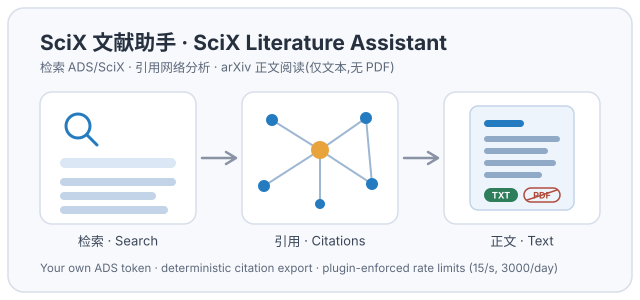

# SciX Literature Assistant

Search the ADS/SciX astronomy literature, analyze citation networks, read arXiv body text, and export citations deterministically — inside DeepSeek Harness conversations, using your own free ADS API token.

## Features

- **Literature search** over ADS/SciX with structured filters (year range, arXiv class) and natural-language queries.
- **Citation analysis**: backward/forward citation traversal, citing-paper lists, and working-set gap analysis.
- **Full-text reading as text only**: section-level body text for arXiv papers that have an HTML rendering. No PDF is ever downloaded, cached, or forwarded.
- **Deterministic citation export**: BibTeX, AASTeX, and RIS produced by the ADS export API and passed through verbatim.
- **Personal library management**: create/edit SciX libraries and add/remove papers.
- **Session working sets**: papers found, cited, or excluded in the current conversation form a dynamic set that later analysis can target.

## The 8 tools

| Tool | Purpose | Key parameters |
|---|---|---|
| `search` | Literature search with filters | `query`, `year_min`, `year_max`, `arxiv_class`, `limit` |
| `get_paper` | Full metadata for one paper | `bibcode` |
| `read_paper` | Read body text (text only, never PDF) | `bibcode`, `section` (optional) |
| `citation_traverse` | Traverse the citation chain | `bibcode`, `direction` (`backward`/`forward`), `mode` (`graph`/`chain`) |
| `forward_citations` | Citing papers, with intent annotations when available | `bibcode` |
| `find_gaps` | Gap analysis over a working set | `working_set_id` |
| `export_citation` | Deterministic bibliography export | `bibcodes`, `format` (`bibtex`/`aastex`/`ris`) |
| `manage_library` | SciX personal library operations | `action`, `library_id`, `bibcodes` |

Identifiers (bibcode, DOI, arXiv id) are returned verbatim from the API — never rewritten or model-completed. Every paper result carries an explicit `body_available` boolean.

## Hard constraints

- **No PDF, ever.** The plugin only fetches metadata and body text through the API and arXiv HTML renderings. It never requests PDF endpoints, never follows PDF redirects, and returns no PDF bytes or download links.
- **Your own token.** Each user supplies their own free ADS API token on the plugin's settings page (Plugins → SciX literature assistant). The token is stored in the local DSH credential store (`SCIX_API_TOKEN`) — never in plugin config, never hardcoded, never shared, and never displayed after saving. Generate one at <https://ui.adsabs.harvard.edu/#user/settings/token>.
- **Rate limits, plugin-enforced.** A FIFO queue caps bursts at **15 requests/second** and a local counter caps usage at **3000 requests/day** per token. On HTTP 429 the plugin backs off exponentially (1 s doubling up to 60 s, at most 5 retries), honors `Retry-After`, and reports a clear rate-limit error when retries are exhausted. (The official ADS policy allows 5000 regular requests/day for most endpoints; the plugin's caps are deliberately conservative. Per-endpoint `X-RateLimit-*` headers remain authoritative.)
- **Deterministic export.** `export_citation` passes the ADS export API's output through unchanged; author/year/DOI/bibcode fields map directly from API data. Nothing is model-"recalled" or completed.

## Honest capability notes

- **Search ranking is lexical, not vector-semantic.** The public ADS/SciX API offers Solr lexical/BM25-style ranking only. The plugin expands queries with the API's `similar()` text-similarity operator and fuses the two ranked lists with Reciprocal Rank Fusion (RRF). This is text similarity, not embedding semantics; no vector index is involved.
- **Body text is arXiv-only.** There is no public ADS/SciX full-text retrieval endpoint. `read_paper` reads arXiv HTML (`arxiv.org/html`) with an ar5iv fallback and parses LaTeXML sections. Papers without an HTML rendering (many older, PDF-only papers) return `body_available: false` with the abstract — never fabricated content.
- **Citation intents are best-effort and external.** ADS/SciX provides no citation-intent data. When available, `forward_citations` enriches results from the Semantic Scholar Graph API, whose real taxonomy is `background` / `method` / `result_comparison`, with limited coverage (S2 full-text holdings only) and possible rate limiting. Labels are attributed to their source and never fabricated; "support/extend/refute" labels exist in no API and are not presented as API data.
- **Gap analysis is heuristic.** `find_gaps` computes client-side over the working set's citation neighborhood and keyword/UAT grouping; candidates are labeled as heuristic suggestions, not verified research gaps.

## Setup

1. Install and enable the bundle, then open **Plugins → SciX literature assistant**.
2. Paste your ADS API token into the token field and press **Save** (stored as a credential), then **Verify** to run one lightweight authenticated probe against the API. **Remove** deletes the stored token.
3. Ask the agent to search, traverse citations, read arXiv text, or export references. Without a token, tools return an actionable missing-token message instead of failing silently.
