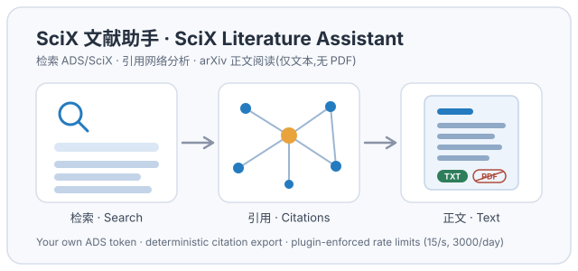

# SciX 文献助手

在 DeepSeek Harness 对话中检索 ADS/SciX 天文学文献、分析引用网络、阅读 arXiv 正文、确定性导出引用——使用你自己的免费 ADS API Token。

## 功能

- **文献检索**:面向 ADS/SciX,支持结构化过滤(年份范围、arXiv 分类)与自然语言查询。
- **引用分析**:向前/向后引用链遍历、施引文献列表、工作集缺口分析。
- **全文阅读(仅文本)**:对具有 HTML 渲染的 arXiv 论文读取章节级正文。绝不下载、缓存或转存任何 PDF。
- **确定性引用导出**:BibTeX、AASTeX、RIS 由 ADS 导出 API 生成并原样透传。
- **个人文库管理**:创建/编辑 SciX 文库,加入或移出论文。
- **会话工作集**:当前对话中检索到、引用到或排除的文献构成动态集合,供后续分析限定范围。

## 8 个工具

| 工具 | 用途 | 关键参数 |
|---|---|---|
| `search` | 带过滤条件的文献检索 | `query`、`year_min`、`year_max`、`arxiv_class`、`limit` |
| `get_paper` | 单篇完整元数据 | `bibcode` |
| `read_paper` | 读取正文文本(仅文本,绝非 PDF) | `bibcode`、`section`(可选) |
| `citation_traverse` | 引用链遍历 | `bibcode`、`direction`(`backward`/`forward`)、`mode`(`graph`/`chain`) |
| `forward_citations` | 施引文献,尽可能附意图标注 | `bibcode` |
| `find_gaps` | 工作集缺口分析 | `working_set_id` |
| `export_citation` | 确定性书目导出 | `bibcodes`、`format`(`bibtex`/`aastex`/`ris`) |
| `manage_library` | SciX 个人文库操作 | `action`、`library_id`、`bibcodes` |

标识符(bibcode、DOI、arXiv id)一律按 API 原文返回,绝不改写或由模型补全。每条论文结果都带显式的 `body_available` 布尔值。

## 硬性约束

- **绝不触碰 PDF。** 插件只通过 API 与 arXiv HTML 渲染获取元数据和正文文本:不请求 PDF 端点、不跟随 PDF 重定向、不返回任何 PDF 字节或下载链接。
- **使用你自己的 Token。** 每位用户在插件设置页(Plugins → SciX 文献助手)填入自己的免费 ADS API Token。Token 保存在本机 DSH 凭据存储(`SCIX_API_TOKEN`)中——绝不写入插件配置、绝不硬编码、绝不共享,保存后不再显示原文。可在 <https://ui.adsabs.harvard.edu/#user/settings/token> 生成。
- **速率限制,插件强制执行。** FIFO 队列将突发限制在 **每秒 15 次请求**,本地计数器将每个 Token 的用量限制在 **每天 3000 次**。遇到 HTTP 429 时指数退避(1 秒起逐次加倍,上限 60 秒,最多重试 5 次),尊重 `Retry-After`,重试耗尽后给出明确的限流错误。(ADS 官方政策对多数端点允许每天 5000 次常规请求;插件的上限刻意保守。各端点的 `X-RateLimit-*` 响应头仍是权威依据。)
- **确定性导出。** `export_citation` 原样透传 ADS 导出 API 的输出;作者/年份/DOI/bibcode 字段直接来自 API 数据,绝不由模型"回忆"或补全。

## 能力边界(如实说明)

- **检索排序是词法的,不是向量语义。** 公开 ADS/SciX API 只提供 Solr 词法/BM25 风格排序。插件用 API 的 `similar()` 文本相似度算子扩展查询,并以倒数排名融合(RRF)合并两个排序列表。这是文本相似,不是嵌入语义;不涉及任何向量索引。
- **正文仅限 arXiv。** ADS/SciX 没有公开的全文获取端点。`read_paper` 读取 arXiv HTML(`arxiv.org/html`),以 ar5iv 为后备,解析 LaTeXML 章节。没有 HTML 渲染的论文(许多较老的、仅 PDF 的论文)返回 `body_available: false` 及摘要——绝不编造内容。
- **施引意图是尽力而为的外部数据。** ADS/SciX 不提供施引意图数据。`forward_citations` 在可用时从 Semantic Scholar Graph API 补充意图数据,其真实分类为 `background` / `method` / `result_comparison`,覆盖有限(仅限 S2 拥有全文的论文)且可能限流。标注一律注明来源、绝不编造;"支持/拓展/反驳"标签不存在于任何 API,也不会被当作 API 数据展示。
- **缺口分析是启发式的。** `find_gaps` 在客户端基于工作集的引用邻域与关键词/UAT 分组计算;候选结果标注为启发式建议,而非经过验证的研究缺口。

## 设置步骤

1. 安装并启用本 bundle,打开 **Plugins → SciX 文献助手**。
2. 将 ADS API Token 粘贴到输入框,点 **保存**(存为凭据),再点 **验证** 对 API 发起一次轻量级带鉴权探测。**移除** 会删除已存 Token。
3. 让智能体检索文献、遍历引用、阅读 arXiv 正文或导出引用。未配置 Token 时,工具返回可操作的缺 Token 提示,而不是静默失败。
